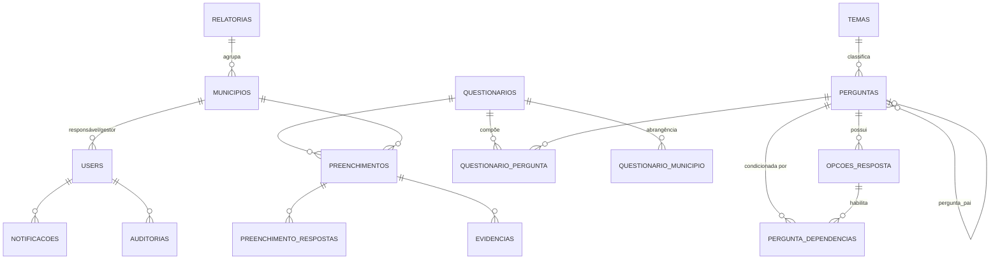
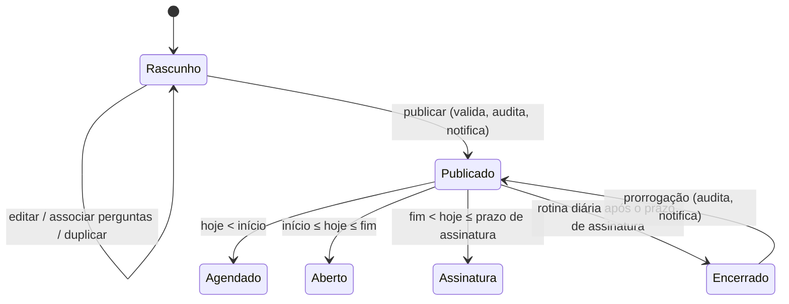
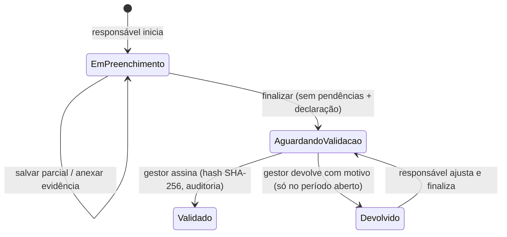

# 01 — Documento de Arquitetura

**Sistema de Diagnóstico da Gestão Tributária Municipal (SDGT)** · Tribunal de Contas do Estado do Tocantins (TCE/TO)
Versão 1.0 · Novembro/2026 · Referências: Documento de Visão 1.0, Memórias de Reunião de 03/11 e 06/11/2026, APF estimada (724,40 PF), Guia de Estilo UI TCE/TO, `Tecnologia.txt`.

## 1. Objetivo e escopo

Plataforma web para aplicação periódica de questionários eletrônicos de diagnóstico aos 139 municípios jurisdicionados, coleta de evidências, validação/assinatura pelo gestor municipal, consolidação de índices de aderência à Reforma Tributária (EC nº 132/2023 e LC nº 214/2025) e disponibilização de painéis e relatórios ao Tribunal.

O escopo implementado corresponde integralmente aos **12 épicos e 65 histórias de usuário** do Documento de Visão (EP01–EP12). A rastreabilidade HU → código → teste está no [Relatório de Testes](05-relatorio-de-testes.md).

## 2. Restrições tecnológicas (definidas pelo cliente)

| Camada | Tecnologia | Versão adotada |
|---|---|---|
| Framework / regras de negócio (MVC) | Laravel | 13.x (PHP 8.3) |
| Apresentação | Blade Template Engine | nativo do Laravel |
| Persistência | Microsoft SQL Server | 2022 (compatível com 2019+) |
| ORM | Eloquent (baixo acoplamento — regras nos *Services*) | nativo |
| Infraestrutura | Docker / Docker Compose | imagem `php:8.3-apache-bookworm` |

Bibliotecas adicionais: `barryvdh/laravel-dompdf` (PDF), `phpoffice/phpspreadsheet` (XLSX), Chart.js 4.4.1 (gráficos, servido localmente em `public/vendor`) e a fonte Montserrat (Guia de Estilo). **Não há etapa de build de front-end** (sem Node/Vite em produção), o que simplifica a replicação.

## 3. Visão geral da solução

```mermaid
flowchart LR
    subgraph Usuarios
      A[Administrador<br/>Auditor]:::t
      M[Responsável<br/>Gestor municipal]:::m
    end
    A -- usuário/senha --> W
    M -- GOV.BR OIDC / e-CPF mTLS --> P[Proxy reverso TCE<br/>TLS + mTLS] --> W
    subgraph Docker
      W[app<br/>Apache + PHP 8.3 + Laravel]
      Q[worker<br/>queue:work]
      S[scheduler<br/>schedule:work]
      DB[(SQL Server 2022)]
      ST[(volume storage<br/>evidências / materiais)]
    end
    W --> DB
    Q --> DB
    S --> DB
    W --> ST
    Q -- SMTP --> MAIL[Servidor de e-mail TCE]
    W -. API .-> CADUN[CADUN]
    W -. API .-> CAL[Calendário Oficial]
    W -. API .-> SFG[SFG - alertas]
    W -. API .-> ICP[Assinatura ICP-Brasil TCE]
    W -. API .-> GA[Gerenciamento de Arquivos TCE]
    classDef t fill:#D6EDFF; classDef m fill:#D6F2CE;
```

Linhas tracejadas = integrações com **driver simulado pronto e driver real codificado conforme contrato presumido**, pendentes de disponibilização das APIs pelo TCE/TO (ver [02 — Integrações Pendentes](02-integracoes-pendentes.md)).

### 3.1 Contêineres (`docker-compose.yml`)

| Serviço | Papel | Observações |
|---|---|---|
| `app` | Servidor web (Apache + mod_php) | Na inicialização: aguarda o SQL Server, cria o banco se não existir, roda migrações e (só na 1ª vez) o seed; faz cache de config/rotas/views. Healthcheck em `/up`. |
| `worker` | Fila (`queue:work`) | Envia os e-mails de notificação (EP10) de forma assíncrona. |
| `scheduler` | Agendador (`schedule:work`) | Executa diariamente (06:00, configurável) `sdgt:processar-marcos`. |
| `sqlserver` | Banco de dados | `mcr.microsoft.com/mssql/server:2022-latest`. Em produção, substituir pelo SQL Server corporativo. |
| `mailpit` | SMTP de testes | Somente homologação. |

Os três primeiros usam **a mesma imagem**; o papel é escolhido pela variável `CONTAINER_ROLE` (`docker/entrypoint.sh`).

## 4. Arquitetura lógica (camadas)

```
routes/web.php                → rotas agrupadas por perfil (middleware perfil:...)
app/Http/Controllers          → orquestram requisição/resposta (finos)
  ├─ Auth/LoginController     → EP01
  ├─ Admin/*                  → EP02, EP03, EP04, EP11, EP12, usuários, municípios
  ├─ Tribunal/*               → EP07, EP08
  └─ Municipio/*, Evidencia…  → EP05, EP06, EP09
app/Services                  → REGRAS DE NEGÓCIO (independentes de HTTP)
  ├─ PontuacaoService         → índice de aderência, dependência entre perguntas, faixas
  ├─ PreenchimentoService     → salvar parcial, pendências, finalizar, validar, devolver
  ├─ QuestionarioService      → publicar, prorrogar, duplicar, rotina de marcos
  ├─ PainelService            → consolidações para painéis e relatórios
  ├─ NotificacaoService       → notificação no sistema + e-mail (fila)
  ├─ AuditoriaService         → trilha de auditoria
  └─ ArquivoService           → abstração do repositório de arquivos (Storage disks)
app/Integracoes               → contratos (interfaces) + drivers locais/reais
app/Models                    → Eloquent (mapeamento das tabelas)
resources/views               → Blade (layouts, telas, PDFs, e-mail)
public/css/sdgt.css           → design system do Guia de Estilo TCE/TO
```

**Princípio de baixo acoplamento ao ORM** (exigência do `Tecnologia.txt`): controllers não contêm regra de negócio; as regras ficam nos *Services* e as integrações atrás de **interfaces** (`app/Integracoes/Contracts`), resolvidas pelo container do Laravel em `AppServiceProvider` conforme `config/sdgt.php`. Trocar uma integração simulada pela real é apenas mudar uma variável de ambiente.

## 5. Modelo de dados



| Tabela | Finalidade | Destaques |
|---|---|---|
| `relatorias`, `municipios` | Jurisdicionados (139 municípios — fonte API IBGE) | `codigo_ibge` único; região imediata para filtros |
| `users` | Usuários e perfis | `perfil` ∈ administrador, auditor, responsavel, gestor; `cpf` (login GOV.BR/certificado) |
| `temas` | EP02 — dimensões de avaliação | 6 temas do item 4 da Visão |
| `perguntas`, `opcoes_resposta`, `pergunta_dependencias` | EP04 | tipos: única, múltipla, texto, número, data; peso; evidência; dependência por opções |
| `questionarios`, `questionario_pergunta`, `questionario_municipio` | EP03 | status rascunho/publicado/encerrado; abrangência todos/selecionados; `origem_id` (duplicação) |
| `preenchimentos`, `preenchimento_respostas` | EP05 | um por município × questionário; índice e `indices_por_tema` (cache para painéis); assinatura (hash) |
| `evidencias` | EP06 | caminho no repositório, SHA-256 do arquivo |
| `notificacoes` | EP09/EP10 | `lida_em`, `email_enviado_em` |
| `materiais_apoio` | EP11 | arquivo ou link externo |
| `auditorias` | EP12 | ação, dados anteriores/novos (JSON), justificativa, IP, user-agent |

**Compatibilidade SQL Server:** (a) apenas relações de composição usam `ON DELETE CASCADE` — o SQL Server rejeita múltiplos caminhos de cascata; (b) não há índice `UNIQUE` em colunas anuláveis (o SQL Server permite um único NULL) — a unicidade do CPF é garantida pela aplicação; (c) o banco é criado com collation UTF-8 `Latin1_General_100_CI_AI_SC_UTF8`. O pipeline de CI executa migrações, seed completo e toda a suíte de testes num SQL Server 2022 real.

## 6. Regras de negócio centrais

### 6.1 Ciclo de vida do questionário

- Prazo padrão: 15 dias corridos + 1 dia útil para assinatura (Memória 03/11), parametrizável e calculado pelo **Calendário Oficial**.
- Após publicado, as perguntas ficam **bloqueadas** (apenas ajuda contextual e link de apoio podem mudar), preservando a consistência histórica.

### 6.2 Preenchimento

- **Perguntas condicionais** permanecem visíveis, mas só são habilitadas quando a resposta da pergunta-pai coincide com uma opção habilitadora (decisão da reunião de 06/11). Respostas de perguntas que deixam de se aplicar são descartadas no servidor.
- **Evidência obrigatória** quando a pergunta exige sempre ou quando a opção marcada “solicita evidência” (ex.: “projeto em tramitação” → anexar o projeto).
- Encerrado o prazo, o preenchimento fica somente para consulta.

### 6.3 Índice de aderência
- Pontuam apenas perguntas de escolha; pontuação = opção(ões) marcada(s) × peso; múltipla escolha limitada ao máximo da pergunta.
- Perguntas desabilitadas pela dependência **não entram no máximo** (não penalizam o município).
- Índice = obtido ÷ máximo × 100, também calculado por tema.
- Faixas (parametrizáveis, **decisão pendente**): baixa ≤ 49,99; média ≤ 74,99; alta acima.
- Validação com faixa baixa dispara alerta ao **SFG** (driver simulado registra em log).

## 7. Segurança

| Tema | Medida |
|---|---|
| Autenticação | Senha (bcrypt) para Tribunal; GOV.BR OIDC com PKCE + `state`; e-CPF via mTLS no proxy (CPF extraído do CN `NOME:CPF` ou OID 2.16.76.1.3.1). Tentativas de login limitadas (10/min). |
| Autorização | Middleware `perfil:` por grupo de rotas + verificação de pertencimento ao município em cada preenchimento/evidência (isolamento entre municípios testado). |
| Sessão / CSRF | Sessão em banco, regeneração no login, token CSRF em todos os formulários. |
| Integridade | Assinatura com hash SHA-256 do conteúdo canônico das respostas + hashes das evidências; trilha de auditoria imutável (sem rotas de alteração). |
| Uploads | Lista branca de extensões, limite de tamanho, nome aleatório no armazenamento, download sempre via controller autorizado (nunca URL pública). |
| Dados pessoais (LGPD) | CPF apenas para identificação; login simulado bloqueado em `APP_ENV=production`. |
| Infra | Imagem sem ferramentas de build; `expose_php=Off`; `TRUSTED_PROXIES` configurável. |

## 8. Identidade visual (Guia de Estilo TCE/TO)

`public/css/sdgt.css`: Montserrat; escala tipográfica Terça Maior (1,250) com base 14 px; paleta principal `#0066B0`/`#00467D` e auxiliares (verde `#44A12B`, vermelho `#DC332E`, amarelo `#FFCA28`); cabeçalho de sistemas (órgão + nome do sistema + usuário + Sair); menu lateral; botões, *text fields*, *dropdowns*, banners de confirmação, controles de seleção e indicadores de progresso conforme seções 5.x do guia. Layout responsivo (grid de 1366 px no desktop, menu recolhível em telas pequenas).

## 9. Replicabilidade como produto

- **Identidade do órgão parametrizada** (`SDGT_ORGAO_NOME`, `SDGT_ORGAO_SIGLA`, `SDGT_ORGAO_UF`, `SDGT_NOME_SISTEMA`, `SDGT_QTD_RELATORIAS`). Para outro Tribunal basta fornecer `database/data/municipios_<uf>.json` (gerado da API do IBGE) e ajustar o `.env`.
- **Regras parametrizadas** (faixas, prazos, lembretes, tamanho de evidência, horário da rotina).
- **Banco de perguntas sugerido** (`BancoPerguntasSeeder`, 27 perguntas) e base de demonstração (`DemoSeeder`).
- **Um comando** para subir tudo: `docker compose up -d --build`.
- **Protótipo navegável** publicado no GitHub Pages a cada push (`.github/workflows/pages.yml`), gerado a partir da base de demonstração da própria aplicação.

## 10. Qualidade e entrega contínua

- 76 testes automatizados (PHPUnit) cobrindo todas as HUs — ver [05](05-relatorio-de-testes.md).
- GitHub Actions: testes em SQLite, testes + migrações + seed em **SQL Server 2022**, build da imagem Docker e publicação do Pages.
