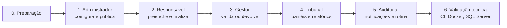

# 07 — Fluxo de como validar tudo

Roteiro para o cliente (ou o QA) validar **todas as funcionalidades**, em ~60 minutos, na demonstração do GitHub Pages ou no ambiente Docker. Marque ✅/❌ em cada passo.

## 0. Preparação

| Opção | Como |
|---|---|
| **A — Demonstração (sem instalar)** | Acesse `https://rodrigomviana.github.io/SDGT/`. Os dados são fictícios e ficam no seu navegador; para recomeçar use **Sobre esta demonstração → Restaurar dados**. Exportações: PDF pela impressão do navegador e XLS gerado localmente. |
| **B — Aplicação real (Docker)** | Siga o [Manual Técnico §2](04-manual-tecnico.md). Acesse `http://localhost:8080`; e-mails em `http://localhost:8025`. PDF e XLSX gerados no servidor. |

Usuários de teste (caixa **Acesso simulado** na tela de login): Administrador, Auditor e, para Palmas, Araguaína, Gurupi, Porto Nacional e Paraíso do Tocantins, um *Responsável Tributário* e um *Gestor Municipal*. Senha do Tribunal: `Sdgt@2026`.

Cenários pré-carregados no ciclo **2026 (aberto)**:

| Município | Situação inicial | Serve para validar |
|---|---|---|
| Gurupi | Não iniciado | Início do preenchimento do zero |
| Palmas | Em preenchimento (~45%) | Retomar preenchimento |
| Araguaína | Aguardando validação | Gestor valida |
| Paraíso do Tocantins | Devolvido para ajustes | Responsável corrige |
| Porto Nacional | Validado | Visualização/PDF |

## 1. Administrador — configuração (EP01–EP04, EP11)

| # | Passo | Resultado esperado | HU |
|---|---|---|---|
| 1.1 | Login com `admin@tceto.tc.br` / `Sdgt@2026` | Abre o *Panorama consolidado* | 01.01 |
| 1.2 | Tentar login com senha errada | "Usuário ou senha inválidos" | 01.01 |
| 1.3 | *Temas*: cadastrar "Transparência Fiscal", editar, inativar e excluir | Operações concluídas com mensagem; tema com perguntas **não** é excluído | 02.01–05 |
| 1.4 | *Perguntas*: filtrar por tema "Recursos Humanos" | Apenas RH01–RH04 | 04.01 |
| 1.5 | Cadastrar pergunta `TF01` (escolha única) e as respostas "Sim" (10, solicita evidência) e "Não" (0) | Pergunta e respostas listadas; pontuação máxima 10 | 04.02, 04.07 |
| 1.6 | Editar/excluir uma resposta | Atualizada/removida | 04.08, 04.09 |
| 1.7 | Abrir `GT02` → ver dependência "GT01 = Sim" | Alerta de dependência atual | 04.05 |
| 1.8 | Abrir `LT01` (usada em questionário publicado) e tentar editar o enunciado | Aviso de bloqueio; só ajuda/link editáveis | regra |
| 1.9 | *Questionários*: abrir o **Ciclo 2027 (rascunho)** → *Associar perguntas* → incluir `TF01` → salvar | Pergunta associada | 03.10 |
| 1.10 | Tentar associar `LT02` sem `LT01` | Erro "dependem de outras perguntas" | 03.10 |
| 1.11 | *Editar* o 2027: data de início = hoje, fim = hoje + 14, abrangência "Somente selecionados" = Gurupi | Salvo; prazo de assinatura calculado se em branco | 03.05 |
| 1.12 | *Baixar PDF* do questionário | PDF com apresentação e perguntas | 03.04 |
| 1.13 | **Publicar** | Situação "Em preenchimento"; registro em auditoria; responsável/gestor de Gurupi notificados | 03.06, 12.01, 09, 10.01 |
| 1.14 | Tentar editar o questionário publicado | Redireciona com aviso; perguntas bloqueadas | 03.05 |
| 1.15 | **Duplicar** o 2027 | Cópia "(cópia)" em rascunho, com as mesmas perguntas | 03.08 |
| 1.16 | **Excluir** a cópia | Excluída (apenas rascunho sem preenchimento) | 03.07 |
| 1.17 | No Ciclo 2026, **Prorrogar prazo** (+3 dias) com justificativa | Novas datas; auditoria com antes/depois; municípios notificados | 03.09, 12.01 |
| 1.18 | *Materiais de apoio*: cadastrar um PDF e um link; inativar um | Inativo não aparece para municípios | 11.01–03 |

## 2. Responsável municipal — preenchimento (EP05, EP06, EP09)

| # | Passo | Resultado esperado | HU |
|---|---|---|---|
| 2.1 | Sair e entrar como **Responsável Tributário — Gurupi** (gov.br simulado) | Lista *Meus questionários* com linha do tempo | 01.02, 05.01 |
| 2.2 | Sino de notificações | Contador de não lidas; abrir uma marca como lida | 09.01–03 |
| 2.3 | Ciclo 2026 → *Iniciar preenchimento* | Apresentação com normativos, materiais e todas as perguntas | 05.02 |
| 2.4 | Iniciar; observar `LT02` | Esmaecida/desabilitada | regra (Memória 06/11) |
| 2.5 | Marcar `LT01 = Não` | `LT02` é habilitada imediatamente | 04.05 |
| 2.6 | Responder algumas perguntas → *Salvar e continuar depois* → sair e voltar | Respostas preservadas; progresso exibido | 05.02, 05.03 |
| 2.7 | Marcar `GT01 = Sim` | Quadro de evidência fica **obrigatório** | 06.01 |
| 2.8 | Anexar um PDF em `GT01`; baixar; excluir; anexar de novo | Arquivo listado, baixa e exclusão funcionam | 06.01–03 |
| 2.9 | *Salvar e revisar* com obrigatórias em branco | Lista de pendências; botão Finalizar desabilitado | 05.04 |
| 2.10 | Responder tudo → revisar → marcar declaração → **Finalizar** | Situação "Aguardando validação"; índice calculado; gestor notificado | 05.04 |
| 2.11 | Tentar editar após finalizar | Redireciona para visualização | regra |
| 2.12 | *Baixar PDF* | PDF com respostas e evidências | 05.06 |
| 2.13 | Entrar como **Responsável — Palmas** | *Continuar preenchimento* traz ~45% respondido | 05.03 |
| 2.14 | Entrar como **Responsável — Paraíso do Tocantins** | Motivo da devolução exibido; questionário editável | regra |

## 3. Gestor municipal — validação (EP05)

| # | Passo | Resultado esperado | HU |
|---|---|---|---|
| 3.1 | Entrar como **Gestor — Gurupi** (certificado simulado) | Notificação "aguardando sua validação" | 01.03, 09 |
| 3.2 | *Revisar e validar* → conferir respostas/evidências | Resumo com índice por tema | 05.05 |
| 3.3 | **Validar e assinar** (marcar declaração) | "Validado"; hash SHA-256 e detalhes da assinatura; responsável notificado; auditoria "Validação" | 05.07, 12.01 |
| 3.4 | Entrar como **Gestor — Araguaína** → **Devolver para ajustes** com motivo | Situação "Devolvido"; responsável notificado | regra |
| 3.5 | Gestor tenta acessar edição (`.../editar`) | Acesso negado (403) | segurança |

## 4. Tribunal — painéis e relatórios (EP07, EP08)

| # | Passo | Resultado esperado | HU |
|---|---|---|---|
| 4.1 | Entrar como **Auditor** | Panorama; menu sem itens de administração | perfis |
| 4.2 | Panorama: trocar o ciclo (2024, 2025, 2026) | KPIs, gráficos (situação, faixas, temas), rankings e regiões mudam | 07.01 |
| 4.3 | *Comparar municípios*: Palmas, Gurupi, Araguaína | Gráfico por tema + tabela | 07.02 |
| 4.4 | *Desempenho por relatoria* | Barras empilhadas por faixa; menores índices; link para os municípios | 07.03 |
| 4.5 | *Evolução* com "Palmas" destacado | Linha estadual × Palmas nos 3 ciclos | 07.04 |
| 4.6 | Abrir um município validado → *Baixar PDF* | Respostas, evidências, assinatura | 07.05, 07.06 |
| 4.7 | *Relatório de resultados*: filtrar faixa = Baixa, relatoria = 1ª | Lista filtrada com índices por tema | 08.01 |
| 4.8 | *Exportar PDF* e *Exportar XLS* | Arquivos gerados com os filtros aplicados | 08.02, 08.03 |
| 4.9 | Auditor tenta abrir `/admin/auditoria` | Acesso negado | segurança |

## 5. Auditoria, notificações e rotina (EP09, EP10, EP12)

| # | Passo | Resultado esperado | HU |
|---|---|---|---|
| 5.1 | Admin → *Auditoria*: filtrar ação = Prorrogação | Registro do passo 1.17 com justificativa | 12.02 |
| 5.2 | *Detalhes* → dados anteriores × novos → *Exportar PDF* | PDF do registro | 12.05, 12.06 |
| 5.3 | *Exportar PDF/XLS* da listagem | Arquivos com os filtros | 12.03, 12.04 |
| 5.4 | **Rotina diária** (Docker: `docker compose exec app php artisan sdgt:processar-marcos`; demo: menu *Rotina diária*) | Contagem de notificações de início/lembrete/encerramento; nada duplicado ao repetir | 10.01, 10.02 |
| 5.5 | Docker: abrir o **Mailpit** | E-mails de início, prorrogação, validação etc. com layout do TCE | 10 |
| 5.6 | Prorrogar o fim de um questionário para hoje+2 e rodar a rotina | Lembrete enviado só a municípios **pendentes** | 10.02 |

## 6. Validação técnica

| # | Verificação | Como | Esperado |
|---|---|---|---|
| 6.1 | Testes automatizados | GitHub → *Actions* → **CI** | 3 jobs verdes: SQLite, **SQL Server 2022**, imagem Docker |
| 6.2 | Testes locais | `php artisan test` | 76 testes / 480 asserções OK |
| 6.3 | Subida limpa | `docker compose down -v && docker compose up -d --build` | `app` saudável; banco criado e populado automaticamente |
| 6.4 | Pages | *Actions* → **Publicar demonstração** | Site e documentação atualizados |
| 6.5 | Identidade visual | Comparar com o Guia de Estilo | Montserrat, azul `#0066B0`, cabeçalho de sistemas, botões e campos do guia |
| 6.6 | Responsividade | Abrir no celular | Menu recolhível, tabelas com rolagem, sem rolagem horizontal da página |

## 7. Critério de aceite sugerido
Todos os passos das seções 1 a 5 ✅ na demonstração **e** no ambiente Docker de homologação do TCE, com as decisões da seção 1 do [documento 06](06-o-que-falta-fazer.md) registradas.
